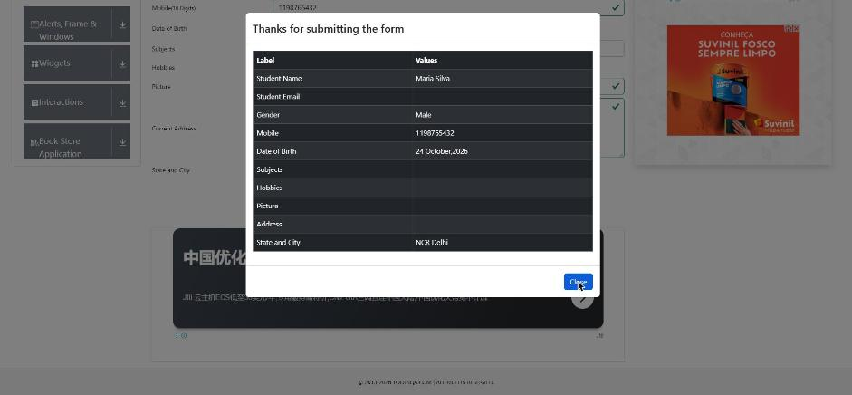
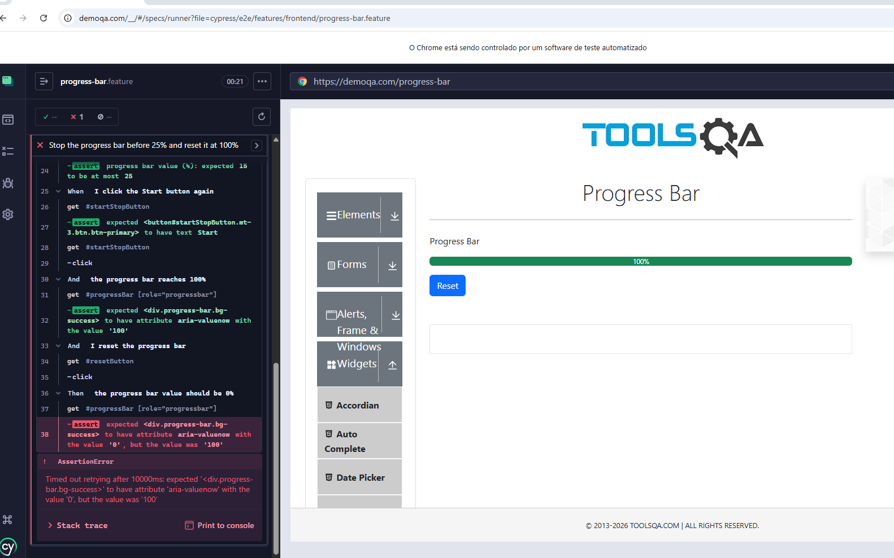
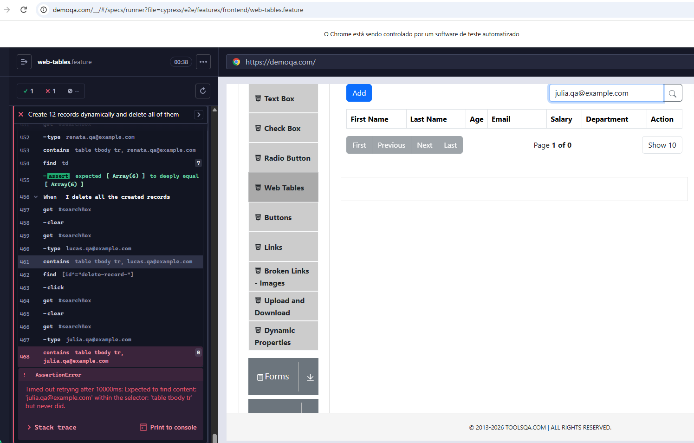

# Bug reports

Defects found in the system under test (https://demoqa.com) while automating the challenge.
The automated scenario that exposes each defect is linked, so anyone can reproduce it.

---

## BUG-001 – Practice Form: the "Close" button does not close the submission popup

| Field              | Value                                                                                               |
| ------------------ | --------------------------------------------------------------------------------------------------- |
| **Severity**       | Medium – the user cannot dismiss the popup with the button meant for it                             |
| **Status**         | Open                                                                                                |
| **Found on**       | 2026-10-24                                                                                          |
| **Environment**    | https://demoqa.com/automation-practice-form – Google Chrome (Windows)                               |
| **Automated test** | `cypress/e2e/features/frontend/practice-form.feature` → _Submit the Practice Form with random data_ |

### Steps to reproduce

1. Open https://demoqa.com, choose **Forms** and then **Practice Form**.
2. Fill in the required fields: First Name, Last Name, Gender and Mobile (10 digits).
3. Click **Submit**.
4. On the popup _"Thanks for submitting the form"_, click **Close** (`#closeLargeModal`).

### Expected result

The popup closes.

### Actual result

The popup stays open. Nothing happens after the click.

### Investigation

| Check                                                 | Result                                                                          |
| ----------------------------------------------------- | ------------------------------------------------------------------------------- |
| Elements with the id `closeLargeModal`                | Exactly 1 – the visible "Close" button inside the popup                         |
| Element on top of the button (something covering it?) | None – the button itself receives the click                                     |
| Real mouse click                                      | Popup stays open                                                                |
| Programmatic click (`element.click()`)                | Popup stays open                                                                |
| Reproduced after reopening the popup                  | Yes                                                                             |
| **Esc** key                                           | Closes the popup (the popup itself can be closed; only the button fails)        |
| Browser console when clicking **Close**               | `TypeError: Lr.findDOMNode is not a function`, thrown by the button's `onClick` |

### Probable root cause

The click handler of the **Close** button throws `TypeError: Lr.findDOMNode is not a function` and stops before closing the popup.
`findDOMNode` was removed from React 19, so the popup component (or a library it uses) still calls an API that no longer exists.
The same error was reported by Cypress in the GitHub Actions run, which fails the test as an uncaught application error.

### Evidence



```
TypeError: Lr.findDOMNode is not a function
    at onClick (https://demoqa.com/assets/index-D_rDx8ml.js:36:57250)
```

---

## BUG-002 – Progress Bar: "Reset" clicked right at 100% restarts the bar

| Field              | Value                                                                                                          |
| ------------------ | -------------------------------------------------------------------------------------------------------------- |
| **Severity**       | Low – only happens if Reset is clicked within about 100 ms after the bar reaches 100%                          |
| **Status**         | Open                                                                                                           |
| **Found on**       | 2026-10-24                                                                                                     |
| **Environment**    | https://demoqa.com/progress-bar – Google Chrome (Windows) and Cypress 16                                       |
| **Automated test** | `cypress/e2e/features/frontend/progress-bar.feature` → _Stop the progress bar before 25% and reset it at 100%_ |

### Steps to reproduce

1. Open https://demoqa.com, choose **Widgets** and then **Progress Bar**.
2. Click **Start** and wait for the bar to reach 100%.
3. Click **Reset** as soon as it appears.

### Expected result

The bar goes back to 0% and stays there, with the **Start** button shown.

### Actual result

The bar goes back to 0% and immediately starts growing again by itself, until it reaches 100% once more.

### Investigation

| Check                                           | Result                                                                                                          |
| ----------------------------------------------- | --------------------------------------------------------------------------------------------------------------- |
| Reset clicked right when the bar reaches 100%   | The bar restarts: 3%, 6%, 9%, 12%…                                                                              |
| Reset clicked 500 ms after the bar reaches 100% | The bar goes to 0% and stays there; the **Start** button is shown                                               |
| Probable cause                                  | The **Reset** button is shown at 100%, but the page timer is only stopped on its next tick (about 100 ms later) |

### Workaround in the automated test

The test pauses for 1 s at 100% before clicking Reset, as a person would.

### Evidence



---

## BUG-003 – Web Tables: deleting a new record does not delete only that record

| Field              | Value                                                                                                       |
| ------------------ | ----------------------------------------------------------------------------------------------------------- |
| **Severity**       | High – the user loses data they did not ask to delete                                                       |
| **Status**         | Open                                                                                                        |
| **Found on**       | 2026-10-25                                                                                                  |
| **Environment**    | https://demoqa.com/webtables – Google Chrome (Windows) and Cypress 16                                       |
| **Automated test** | `cypress/e2e/features/frontend/web-tables.feature` → _Create 12 records dynamically and delete all of them_ |

### Steps to reproduce

1. Open https://demoqa.com, choose **Elements** and then **Web Tables**.
2. Click **Add** and create 3 records (for example Lucas, Julia and Pedro).
3. Click the **Delete** icon of only one of them (for example Julia).

### Expected result

Only the chosen record is removed. The other two stay in the table.

### Actual result

The delete of records created by the user is broken. It was observed in two different ways:

- **Automated and scripted runs:** all the records created by the user are removed at once (Lucas, Julia and Pedro). Only the 3 records that come with the page remain.
- **Manual run** (records typed by hand, second tester): the last 2 records created could not be deleted.

In both cases, the records cannot be deleted one by one.

### Investigation

**Reproduction 1 – automated and scripted runs**

| Action (table: Cierra, Alden, Kierra + Lucas, Julia, Pedro)  | Result                                                                   |
| ------------------------------------------------------------ | ------------------------------------------------------------------------ |
| Delete **Alden** (a record that comes with the page)         | Only Alden is removed ✅                                                 |
| Delete **Lucas** (first new record)                          | Lucas, Julia and Pedro are removed ❌                                    |
| Delete **Julia** (new record in the middle)                  | Lucas, Julia and Pedro are removed ❌                                    |
| Delete **Pedro** (last new record)                           | Lucas, Julia and Pedro are removed ❌                                    |
| Delete **Lucas** with the search box filtering by his email  | Lucas and Julia are removed ❌ (same defect, with or without the search) |
| Real mouse click on the **Julia** trash icon (2 new records) | Lucas and Julia are removed ❌                                           |
| Cypress bonus scenario (12 new records), delete **Lucas**    | All 12 new records are removed ❌                                        |

**Reproduction 2 – manual run, records typed by hand**

| Action                                                  | Result                                |
| ------------------------------------------------------- | ------------------------------------- |
| Create new records and click the trash icon of each one | The last 2 records are not deleted ❌ |

**Note:** after a page refresh the table always goes back to its 3 initial records (Cierra, Alden and Kierra), because the page does not keep any data. This is expected and is not part of the defect.

### Evidence


